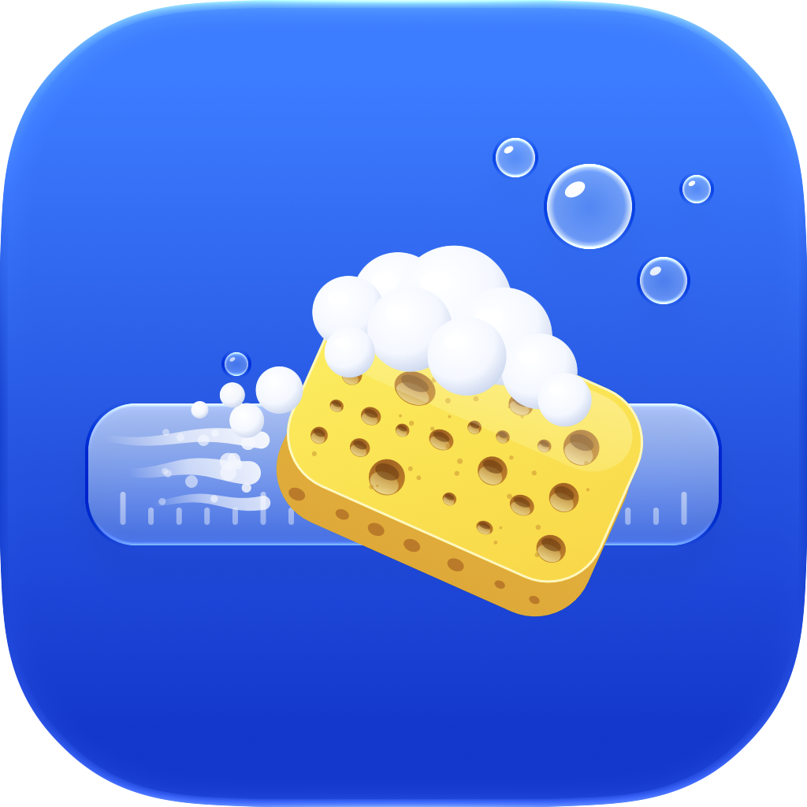

# Video Scrubber



Describe a moment and find it. Video Scrubber transcribes your videos, pulls a key frame at every scene change, and lets you search what's said and what's on screen across one video or many at once. Everything runs on your machine with local AI models, accelerated by whatever GPU you have.

- **Find**: type "Jonah demos the app on his phone" or "the pricing whiteboard". Results combine speech (meaning plus keywords), picture search on the key frames, and frame descriptions. Nearby hits merge into one moment.
- **Transcript**: timestamped speech with `.txt` and `.srt` export.
- **Transcribe + Show**: the transcript grouped under the key frame that was on screen, with a one-line description of each frame.
- **Comb many videos**: open or drop as many videos as you like. They index in parallel, and Find can search *this video* or *all videos*.
- **Clips**: drag a range on the timeline (or press `I`/`O`), then export a frame-accurate video clip on the hardware encoder, extract the audio, or save the frame.
- **Download**: paste a link to a file, most video sites, or a whole playlist. It downloads and indexes automatically.

The UI implements the *Video Scrubber v2* design (`design/Video Scrubber v2.dc.html`).

## How it works

```
Tauri shell (Rust)          React UI (src/)            Local engine (engine/, Python)
 ├ first-run setup  ──────▶  talks to the engine  ───▶  FastAPI on 127.0.0.1, per-launch token
 ├ spawns + restarts engine  over HTTP + SSE            ├ ffmpeg: probe, audio, scene cuts, key frames, clips
 └ dialogs, drag-drop,                                  ├ speech-to-text, picture + text embeddings, captions
   file associations                                    └ indexing queue, search, yt-dlp downloads
```

On first launch the app creates a Python environment (in the app's data folder) with the PyTorch build that matches your hardware. Models download the first time they're used and are cached in the Hugging Face cache. Video indexes live in the engine's data folder (`~/Library/Application Support/Video Scrubber` on macOS, `%APPDATA%\Video Scrubber` on Windows, `~/.local/share/video-scrubber` on Linux).

## Hardware acceleration

| Machine | Speech to text | Picture search, descriptions, text search | Clip export |
|---|---|---|---|
| Apple Silicon Mac | MLX (Metal) | PyTorch MPS (Metal) | VideoToolbox |
| NVIDIA (Windows, Linux) | faster-whisper on CUDA | PyTorch CUDA | NVENC |
| AMD on Linux | PyTorch ROCm | PyTorch ROCm | VAAPI |
| AMD / Intel on Windows | PyTorch DirectML | PyTorch DirectML | AMF / Quick Sync / Media Foundation |
| Intel Arc | PyTorch XPU | PyTorch XPU | Quick Sync |
| Any CPU | faster-whisper int8, or whisper.cpp | PyTorch CPU | libx264 |

If `whisper-cli` ([whisper.cpp](https://github.com/ggml-org/whisper.cpp)) is installed, it's available as a speech engine too (Metal, CUDA or Vulkan, depending on how it was built). Frame descriptions can also run through [Ollama](https://ollama.com), which accelerates on Metal, CUDA, ROCm and Vulkan.

## Models

Every model downloads from Hugging Face the first time it's needed, then runs offline. Open the status pill in the top-right corner to see them all, with quality and speed ratings, memory needed, download size and license.

**Recommendations.** On first launch, and whenever you press *Use recommended*, Video Scrubber reads this machine's GPU memory (or unified memory on Apple Silicon, or RAM), sets aside a share of it for models, and picks the highest-quality combination of speech, description, picture and text models that fits in memory at the same time. It looks at every combination, favouring quality first and speed second, and accounts for the runtime each model will use here: a 4-bit MLX build on Apple Silicon needs much less memory than the same model in fp16 on PyTorch. English-only models are only suggested when the spoken language is set to English. Downloads check free disk space first.

| Job | Hugging Face models | Runs on |
|---|---|---|
| Speech to text | Whisper large-v3 turbo, large-v3, medium, medium.en, small, base, tiny · Distil-Whisper large-v3.5, large-v3, small.en · Moonshine base, tiny | MLX, faster-whisper, whisper.cpp, PyTorch |
| Frame descriptions | Qwen3-VL 8B / 4B / 2B · Qwen2.5-VL 7B · InternVL3 8B / 2B / 1B · SmolVLM2 2.2B · SmolVLM 500M / 256M | MLX 4-bit, PyTorch |
| Picture search | SigLIP so400m, SigLIP 2 base, SigLIP base · CLIP ViT-L/14, ViT-B/32 | PyTorch |
| Meaning search | BGE-M3, mxbai embed large, BGE base/small en v1.5, Nomic Embed v1.5, Multilingual E5 small, MiniLM L6 v2 | PyTorch |

Quality and speed are curated relative rankings within each job, not benchmark scores. Gated models (ones that need a Hugging Face account) aren't included. If [Ollama](https://ollama.com) is running, Gemma 3, MiniCPM-V, Llama 3.2 Vision, LLaVA and Moondream show up as extra frame describers.

## Develop

Requirements: Node 20+, Rust (stable), ffmpeg on `PATH` (the engine falls back to a bundled ffmpeg if it's missing), and [uv](https://docs.astral.sh/uv/) or Python 3.10–3.13. On Linux, also install the [Tauri system dependencies](https://tauri.app/start/prerequisites/#linux) and GStreamer's `gst-libav` for video playback.

```sh
npm install
npm run dev        # builds the engine environment on first run, then opens the app
```

The engine also runs on its own, which is handy for scripting:

```sh
cd engine && .venv/bin/python -m vscrubber --port 8765
curl -X POST localhost:8765/library -H 'content-type: application/json' -d '{"paths":["/path/to/video.mp4"]}'
curl -X POST localhost:8765/search  -H 'content-type: application/json' -d '{"q":"the pricing whiteboard"}'
```

## Build

```sh
npm run build      # installers for the current OS in src-tauri/target/release/bundle
```

GitHub Actions builds macOS (Apple Silicon), Windows and Linux installers on every push. Pushing a `v*` tag drafts a release with them attached. Builds aren't code-signed yet, so macOS asks you to approve the app in System Settings › Privacy & Security on first open.

## Icon

The app icon is an Icon Composer document, `design/icon/AppIcon.icon`, built in layers: a blue gradient, a Liquid Glass timeline, the soap streaks and suds, the sponge, and glass bubbles. `design/icon/build_icon.py` generates it, so it can be tweaked in code or opened and edited in Icon Composer (Xcode 26+). After changing it, run `sh design/icon/export.sh` to regenerate the Liquid Glass `Assets.car` for macOS 26+ and the `.icns`, `.ico` and PNG icons for other platforms.

## Keyboard

| Key | Action |
|---|---|
| `Space` | Play / pause |
| `←` `→` | Previous / next frame (`Shift`: 5 s) |
| `J` `L` | Back / forward 10 s |
| `I` `O` | Set range in / out |
| `⌘K` / `Ctrl K`, `/` | Find |
| `⌘O` / `Ctrl O` | Open videos |
| `Esc` | Clear range |

## License

Video Scrubber is free software: you can redistribute it and/or modify it under the terms of the GNU General Public License as published by the Free Software Foundation, either version 3 of the License, or (at your option) any later version. It is distributed in the hope that it will be useful, but without any warranty; see [LICENSE](LICENSE) for details.

Model weights are not part of this repository. Each is downloaded from Hugging Face under its own license (MIT, Apache-2.0, or the Qwen license for InternVL3), shown in the app on every model card.
